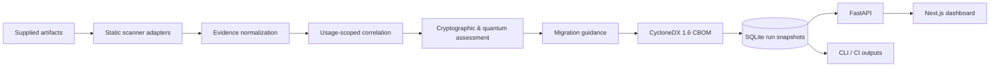

# QRYPTON

### Cryptographic discovery · Explainable quantum-risk assessment · Post-quantum migration planning

[](https://github.com/Siddharth-1447/QRYPTON/actions/workflows/ci.yml)
[](https://github.com/Siddharth-1447/QRYPTON/actions/workflows/repository-hygiene.yml)


**Know where cryptography is used. Understand the evidence. Prioritize what needs to change.**

QRYPTON is a cryptographic inventory and quantum-readiness assessment platform. It statically inspects supported software artifacts, translates observations into traceable cryptographic findings, evaluates their security and quantum-migration implications, and generates evidence-linked outputs—including a CycloneDX 1.6 **Cryptographic Bill of Materials (CBOM)**.

Instead of treating every mention of RSA, ECC, or a cryptographic library as equally urgent, QRYPTON distinguishes **what was observed**, **where the evidence came from**, **what the evidence actually establishes**, and **which unknowns require human investigation**.

[Quick start](#quick-start) · [Capabilities](#capabilities) · [Architecture](#architecture) · [Documentation](docs/README.md) · [Security boundaries](#security-and-limitations)

> **Status — v0.1.0:** Under active development and intended for trusted local evaluation. Not production-hardened, independently certified, or a substitute for runtime verification or compliance assessment.

---

## The problem

A credible transition to post-quantum cryptography starts with a trustworthy inventory—not a list of algorithm names. Security engineers need to know **where** cryptographic functionality appears, **how confidently** it has been identified, **what role** it serves, and **what should be investigated or migrated first**.

A binary import, a library dependency, and a concrete source-code invocation carry different evidentiary weight. QRYPTON preserves that distinction, allowing teams to review findings rather than accept an unexplained severity label.

## Capabilities

| Area | Implementation |
| --- | --- |
| **Discovery** | Static inspection of supported source files, ELF/PE/Mach-O metadata, dependency manifests, supplied archives, container artifacts, and infrastructure descriptors. |
| **Evidence provenance** | Artifact digests, source locations, scanner provenance, observation states, confidence indicators, and inspection limitations. |
| **Correlation** | Usage-scoped normalization that avoids combining unrelated occurrences solely because they name the same algorithm. |
| **Risk assessment** | Separate consideration of classical cryptographic condition, quantum exposure, contextual impact, and unknowns. |
| **Migration planning** | Mosca-inspired planning inputs, cryptographic-role-aware recommendations, and remediation ranking. |
| **CBOM export** | Schema-validated CycloneDX 1.6 CBOM JSON with assessment metadata. |
| **Investigations** | Persisted scan history, finding views, analyst status and ownership, and comparisons. |
| **Delivery** | CLI/CI policy checks, JSON and CSV results, executive PDF reporting, and a web dashboard. |

**Design principle:** Missing evidence is not proof of safety. Incomplete inspections and unresolved parameters remain explicit.

## Interface


*Dashboard preview using synthetic browser-test fixtures. This is not an independently validated enterprise assessment.*

## Architecture



The CLI and API compose the same Python application layer. Scanner adapters, domain contracts, correlation rules, policy evaluation, persistence, and presentation are separated so each step can retain its provenance and limitations.

**Architecture decisions:**

- **Evidence before inference:** A symbol or dependency indicates a reference, not guaranteed runtime cryptographic use.
- **Explicit uncertainty:** Missing context and partial scans remain visible rather than being silently treated as safe.
- **Recorded decisions:** Persisted assessment snapshots retain their policy context instead of being silently recalculated when policies change.
- **Static target inspection:** Supplied target code is not executed by the scanning core.
- **Scoped correlation:** Findings are matched using usage/context identity, not algorithm-name coincidence.

See [architecture](docs/architecture.md), [evidence and correlation contracts](docs/normalization-correlation-v1.0.md), and [risk modeling](docs/risk-model-v1.0.md).

## Coverage and interpretation

| Surface | Approach | Interpretation boundary |
| --- | --- | --- |
| Python | AST with lexical fallback | Does not establish the path executes at runtime. |
| C/C++ | Lexical inspection | Not a whole-program semantic analyzer. |
| Executables | ELF, PE, Mach-O imports, symbols, strings, metadata | Matching symbols do not prove runtime usage. |
| Dependencies | Supplied manifest/package evidence | Presence of a library does not establish specific cryptographic usage. |
| Archives/containers | Supported supplied artifacts and descriptors | A bare image reference does not prove registry layers were scanned. |
| Cloud KMS | Static identifiers and supplied descriptors | No authenticated, live KMS inventory or key-state verification. |
| Remote repositories | Supported API acquisition followed by static inspection | Network acquisition is separate from the offline inspection engine. |

A completed scan indicates the workflow finished; it does **not** certify inventory completeness. Consult [scanner limitations](docs/configuration.md#scanner-limitations).

## Risk and PQC methodology

QRYPTON separates inventory findings from security judgments and migration-planning decisions:

1. **Classical cryptographic condition:** Identify potentially weak or deprecated constructions without claiming observed use is automatically exploitable.
2. **Quantum relevance:** Distinguish key establishment, digital signatures, and symmetric constructions, rather than applying one severity rule to all cryptography.
3. **Business context:** Incorporate sensitivity, protection lifetime, exposure, criticality, and migration constraints when available; preserve unknowns when not.
4. **Mosca planning urgency:** Treat X/Y/Z inputs as scenarios for prioritization, **not a prediction** of when a quantum-capable adversary will exist.
5. **PQC guidance:** Present reviewable recommendations related to standards such as [ML-KEM / FIPS 203](https://csrc.nist.gov/pubs/fips/203/final), [ML-DSA / FIPS 204](https://csrc.nist.gov/pubs/fips/204/final), and [SLH-DSA / FIPS 205](https://csrc.nist.gov/pubs/fips/205/final).

Recommendations are candidate engineering actions, **not automatically verified migrations**, cryptographic module validation, or compliance certification. See the [risk model](docs/risk-model-v1.0.md) and [remediation ranking](docs/remediation-ranking-v1.0.md).

## Quick start

### Requirements

- Python **3.11–3.13**, Git
- Node.js **22.18+** and npm for the optional Next.js dashboard
- No Docker daemon or cloud account required for the local demo

### Install (Linux / macOS)

```bash
git clone https://github.com/Siddharth-1447/QRYPTON.git
cd QRYPTON
python3 -m venv .venv
source .venv/bin/activate
python -m pip install --upgrade 'pip>=26.2'
python -m pip install -e '.[dev]'
qrypton --version
```

On Windows PowerShell, use `python -m venv .venv`, activate using `.\.venv\Scripts\Activate.ps1`, and run the same pip commands. See [getting started](docs/getting-started.md) for complete platform-specific setup.

### Run the controlled demonstration

```bash
python scripts/run_demo.py
```

The demo scans intentionally constructed sample inputs, persists evidence, produces a CBOM, and exercises a CI policy violation. It writes artifacts under the ignored `artifacts/` directory. **The fixtures deliberately contain weak cryptography; do not deploy them.**

### Inspect the CLI

```bash
qrypton scan --help
qrypton report --help
qrypton ci scan --help
```

The [CLI guide](docs/cli.md) provides a reproducible source scan, tenant/identity setup, report export, and CI baseline comparison. A persistent workspace requires consistent `QRYPTON_TENANT_ID` and a stable, confidential `QRYPTON_ID_SECRET` (at least 32 UTF-8 bytes).

### Launch the web interface (optional)

```bash
npm --prefix web ci
```

Start the API in one terminal after configuring its database, tenant, and secret as described in the [setup guide](docs/getting-started.md):

```bash
python -m uvicorn qrypton.api.app:app --host 127.0.0.1 --port 8000
```

Start the Next.js frontend in another terminal:

```bash
npm --prefix web run dev -- --hostname 127.0.0.1
```

- Dashboard: http://localhost:3000
- API reference: http://127.0.0.1:8000/docs
- Health check: http://127.0.0.1:8000/api/v1/health

**Keep services on loopback.** The current API is not hardened for public or multi-tenant deployment. For persistent data, ensure CLI and API use the same `QRYPTON_DB`, `QRYPTON_TENANT_ID`, and `QRYPTON_ID_SECRET`.

## Technology

| Layer | Stack |
| --- | --- |
| Core and domain modeling | Python, Pydantic v2 |
| Analysis | Python AST/lexical and executable metadata adapters |
| Assessment | Versioned risk policies, Mosca planning, role-aware recommendation rules |
| Service | FastAPI |
| Frontend | Next.js, React, TypeScript |
| Persistence | SQLite |
| Export and reporting | CycloneDX 1.6, JSON, CSV, PDF |
| Engineering | pytest, Hypothesis, Ruff, mypy, GitHub Actions, Docker checks |

## Verification and development

The repository includes backend unit/integration/property/adversarial tests, frontend checks, packaging verification, and automation. These commands describe the checks available; **they are not a claim that every gate currently passes**.

```bash
python scripts/check_repository.py
python -m ruff check .
python -m mypy src
python -m pytest
npm --prefix web ci
npm --prefix web test
npm --prefix web run lint
npm --prefix web run typecheck
npm --prefix web run build
```

The [GitHub Actions CI workflow](.github/workflows/ci.yml) defines Python, web, wheel-packaging, and container checks. Optional [PR scanning](.github/workflows/qrypton-pr.yml) and [baseline refresh](.github/workflows/qrypton-baseline.yml) require repository configuration and may skip scanning if secrets or variables are absent. Static type-check coverage is not comprehensive for the API. Browser end-to-end and production security validation are separate from unit tests.

## Security and limitations

> **Deployment boundary:** QRYPTON v0.1.0 is designed for trusted local evaluation. Selected analyst actions enforce roles, but authentication and tenant authorization do **not** consistently protect every API route. Do not expose this build to the public internet or use it as a multi-tenant hosted service.

- Static evidence does not prove actual runtime use, exploitability, comprehensive discovery, successful migration, or legal/regulatory compliance.
- Container references and KMS identifiers do not establish inspected images or authenticated, live key state.
- Scanning workers run in-process; deadlines are cooperative, isolation is limited, and queued jobs are not durably recovered across restarts.
- Untrusted artifacts, uploads, database files, secrets, and generated reports require appropriate storage and access controls.
- A PQC algorithm match or recommendation does not establish protocol security, certification, or FIPS 140 module validation.

Only inspect targets you own or are authorized to analyze. Read [SECURITY.md](SECURITY.md), [configuration and limitations](docs/configuration.md), and [architecture trust boundaries](docs/architecture.md#trust-and-deployment-boundaries) before use outside a local lab.

## Documentation

| Guide | Focus |
| --- | --- |
| [Getting started](docs/getting-started.md) | Installation, demo, API, dashboard |
| [CLI and CI](docs/cli.md) | Scan and report options, baseline comparison, exit codes |
| [Architecture](docs/architecture.md) | Components, data flow, trust boundaries |
| [Evidence and correlation](docs/normalization-correlation-v1.0.md) | Provenance, identity, observation states |
| [Risk model](docs/risk-model-v1.0.md) | Classical/quantum assessments and Mosca inputs |
| [Remediation ranking](docs/remediation-ranking-v1.0.md) | Prioritization methodology |
| [Configuration](docs/configuration.md) | Environment, integrations, security constraints |
| [Documentation index](docs/README.md) | Further operational and engineering guides |

## Contributing and vulnerability reports

See [CONTRIBUTING.md](CONTRIBUTING.md) for project conventions and checks. Report suspected vulnerabilities through the process in [SECURITY.md](SECURITY.md); avoid disclosing exploitable details in public issues.

## License

**© 2026 Siddharth Patel. All rights reserved.**

QRYPTON is **proprietary**. Public repository visibility does not grant an open-source license or permission to use, reproduce, modify, or redistribute its contents. See [LICENSE](LICENSE); third-party components retain their respective licenses.
