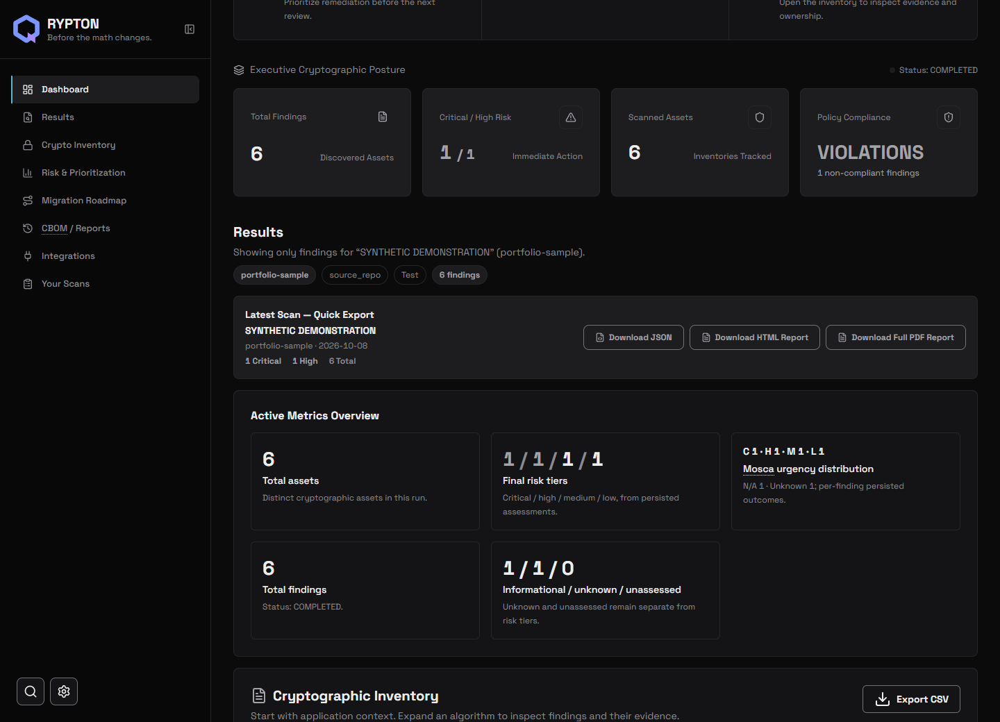
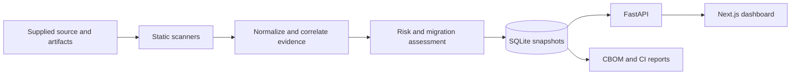

# QRYPTON

**Cryptographic discovery and quantum migration planning.**

[](https://github.com/Siddharth-1447/QRYPTON/actions/workflows/ci.yml)
[](https://github.com/Siddharth-1447/QRYPTON/actions/workflows/repository-hygiene.yml)


QRYPTON helps security teams answer three questions: **Where is cryptography used?
What evidence supports the assessment? What should migrate first?** It statically
inspects supplied artifacts, builds an evidence-backed inventory, evaluates
cryptographic and quantum risk, and exports a CycloneDX 1.6 cryptographic bill of
materials (CBOM).

[Get started](docs/getting-started.md) · [CLI guide](docs/cli.md) ·
[Architecture](docs/architecture.md) · [Documentation](docs/README.md)

**Status:** version `0.1.0`, intended for local development and evaluation. Static
findings support investigation; they do not prove runtime use or compliance.
The API requires additional authentication and tenant-isolation work before
public deployment. See [security boundaries](docs/configuration.md#scanner-limitations).



*Dashboard preview using synthetic browser-test fixtures.*

## What it does

| Capability | Implementation |
| --- | --- |
| Discover cryptography | Python AST and C/C++ lexical inspection; ELF, PE, and Mach-O metadata; supplied archives, dependency manifests, container artifacts, and KMS descriptors. Target code is never executed. |
| Keep evidence traceable | Artifact digests, source anchors, scanner provenance, confidence, explicit unknown states, and deterministic correlation. |
| Prioritize migration | Cryptographic and quantum assessment, business context, Mosca timelines, PQC recommendations, and ranked remediation. |
| Investigate findings | Persisted scan history, inventory filters, finding ownership and status, scan comparisons, and labeled synthetic sample data. |
| Share results | CycloneDX 1.6 CBOM, CSV, executive PDF, and sanitized CI deltas against a trusted baseline. |

## Try it locally

Requires Python **3.11–3.13**. The dashboard also requires Node.js **22.18+**.
From a fresh clone on Linux or macOS:

```bash
git clone https://github.com/Siddharth-1447/QRYPTON.git
cd QRYPTON
python3 -m venv .venv
. .venv/bin/activate
python -m pip install --upgrade 'pip>=26.2'
python -m pip install -e '.[dev]'
python scripts/run_demo.py
```

On Windows, activate the environment with `.\.venv\Scripts\Activate.ps1`.
The [setup guide](docs/getting-started.md) includes complete PowerShell commands
and instructions for starting the API and dashboards.

The demo scans a controlled fixture, persists its evidence, exports a CBOM, and
checks an intentional policy violation. It writes to the ignored `artifacts/`
directory. Demo fixtures deliberately contain weak cryptography; do not deploy them.

## How it fits together



The CLI and API share the Python application layer. Domain models and adapter
interfaces keep discovery, policy, storage, and reporting separate. The
[architecture guide](docs/architecture.md) explains the implementation and trust
boundaries; a legacy Streamlit dashboard provides a read-only view.

## Repository layout

```text
QRYPTON/
├── src/qrypton/       # Python domain, scanners, API, CLI, storage, exporters
├── web/               # Next.js dashboard, assets, and frontend tests
├── tests/             # Backend unit, property, integration, adversarial tests
├── demo/              # Controlled enterprise demonstration fixtures
├── demo_corpus/       # Small scanner and CI policy examples
├── docs/              # Setup, architecture, contracts, and operating guides
├── scripts/           # Development launchers, demos, repository checks
├── tools/             # Enterprise demo verification
└── .github/           # CI workflows and contribution templates
```

## Development

After installing `.[dev]`, run from the repository root:

```bash
python scripts/check_repository.py
python -m ruff check .
python -m mypy src
python -m pytest
npm --prefix web ci
npm --prefix web test
npm --prefix web run lint
npm --prefix web run typecheck
npm --prefix web run build
```

[Repository checks](.github/workflows/ci.yml) also verify wheel packaging and the
non-root container. Mypy currently suppresses API-module errors; passing it does
not establish full API typing. Browser probes are separate manual checks with
environment-specific requirements; they are not part of `npm test`.

The optional [PR policy gate](.github/workflows/qrypton-pr.yml) and
[baseline refresh](.github/workflows/qrypton-baseline.yml) need a repository
`QRYPTON_ID_SECRET` secret and `QRYPTON_TENANT_ID` variable. See the
[configuration guide](docs/configuration.md#ci-policy-workflows) for setup.

Read [CONTRIBUTING.md](CONTRIBUTING.md) before submitting changes and
[SECURITY.md](SECURITY.md) for vulnerability reporting.

## License

Copyright (c) 2026 Siddharth Patel. All rights reserved. The project is proprietary;
public source visibility does not grant an open-source license. Bundled dependency
and asset licenses remain applicable. See [LICENSE](LICENSE).
