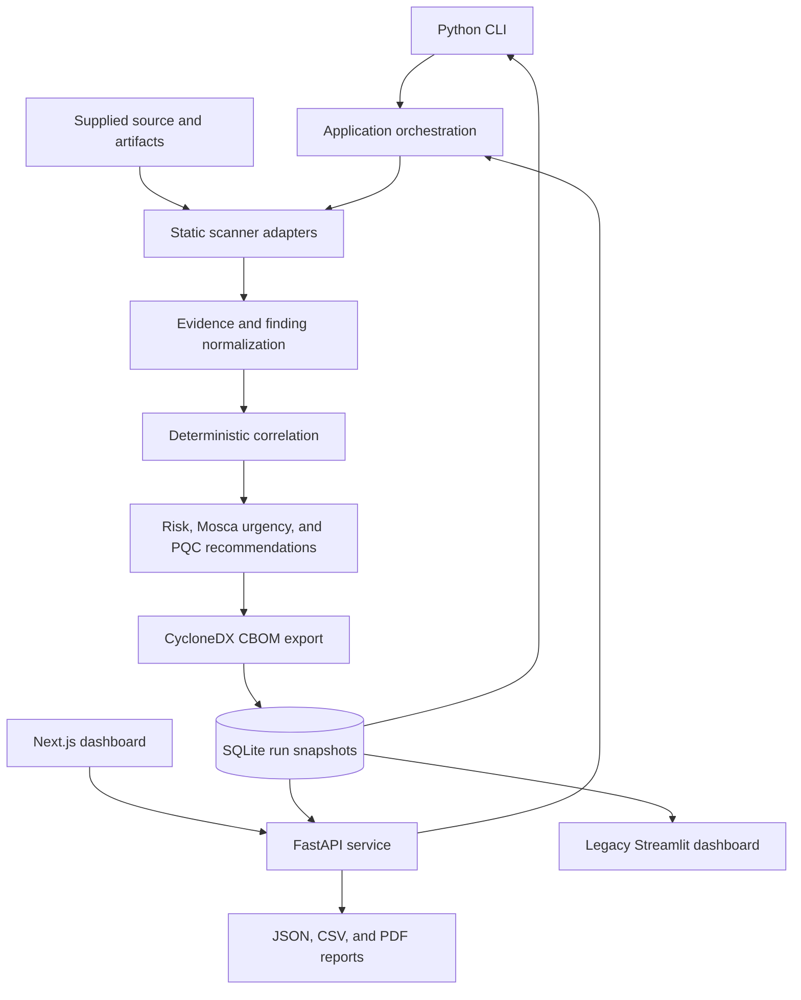

# Architecture

QRYPTON combines a Python CLI, FastAPI service, Next.js dashboard, and a legacy
read-only Streamlit dashboard. Both scan entry points compose the same backend
services. Static observations become evidence-backed findings, persisted risk
assessments, recommendations, and CycloneDX 1.6 CBOM exports.

The diagram shows the principal scan and read paths. API workers also record
queue state, progress, and heartbeats before a finalized result is available.
Analyst status and ownership changes are stored separately from immutable scan
snapshots.

## Component map

| Component | Source | Responsibility |
| --- | --- | --- |
| Entry points | [`cli.py`](../src/qrypton/cli.py), [`api/`](../src/qrypton/api/) | Validate requests, select targets, submit scans, and expose results. |
| Composition and orchestration | [`application/`](../src/qrypton/application/) | Assemble adapters, coordinate scan stages, and retain explicit failures. |
| Domain contracts | [`contracts/`](../src/qrypton/contracts/), [`ports/`](../src/qrypton/ports/) | Validated models, evidence semantics, identifiers, and adapter interfaces. |
| Static discovery | [`scanners/`](../src/qrypton/scanners/) | Inspect supplied source, binaries, archives, and descriptor/manifest evidence. |
| Assessment | [`risk/`](../src/qrypton/risk/), [`recommendations/`](../src/qrypton/recommendations/), [`policies/`](../src/qrypton/policies/) | Classify observed cryptography and calculate context-dependent migration priorities. |
| Persistence and exports | [`storage/`](../src/qrypton/storage/), [`exporters/`](../src/qrypton/exporters/), [`ci/`](../src/qrypton/ci/) | Store run snapshots, export CBOMs, and compare sanitized CI inventories. |
| Presentation | [`web/`](../web/), [`ui/`](../src/qrypton/ui/) | Display persisted inventory, history, risk, and migration actions. |

[`application/config.py`](../src/qrypton/application/config.py) is the concrete
composition root. It connects scanner adapters, normalizers, correlation, the
Mosca risk engine, recommendation policy, CBOM exporter, and SQLite store through
the interfaces under `ports/`.

## Evidence and result flow

1. The CLI or API validates scan metadata and resolves the supplied target.
2. Eligible adapters inspect target contents without executing target code.
   Python uses AST analysis with lexical fallback; C/C++ uses lexical inspection.
   Binary adapters inspect format metadata, symbols, and other static evidence.
3. Normalizers attach provenance, location anchors, observed parameters, and
   explicit unknown states. Correlation groups observations of the same usage;
   an algorithm name alone does not establish shared usage identity.
4. Risk and recommendation services assess the recorded evidence and business
   context. Missing context remains unknown. Mosca timelines are scenario inputs,
   not predictions that a quantum-capable adversary exists on a particular date.
5. The exporter produces a CBOM, and the run store finalizes a snapshot. Dashboard
   projections and reports read that recorded result. A later policy change does
   not silently recalculate historical assessments.

See the [evidence contract](normalization-correlation-v1.0.md),
[risk model](risk-model-v1.0.md), and [remediation ranking](remediation-ranking-v1.0.md)
for the domain rules.

## Trust and deployment boundaries

The supplied application is intended for trusted local evaluation. Keep the API
and dashboards bound to loopback. Selected analyst actions enforce roles, but
authentication and tenant ownership checks do not cover every endpoint; a tenant
query parameter is not an authorization boundary. See [SECURITY.md](../SECURITY.md).

Treat targets as untrusted data. Static inspection does not prove runtime use,
complete discovery, successful remediation, or compliance. Container references
and KMS identifiers can be descriptor evidence only; this version does not pull
registries or query authenticated cloud KMS metadata.

The API uses process-local threads and sessions. Timeouts are cooperative, and
queued scans are not recovered after a restart. The current worker does not offer
hard process or memory isolation; see the [worker lifecycle](scan-worker-remediation.md).
Keep uploaded artifacts, databases, ID secrets, credentials, and generated reports
outside version control. Export redaction does not remove the need to protect
underlying workspace files.
